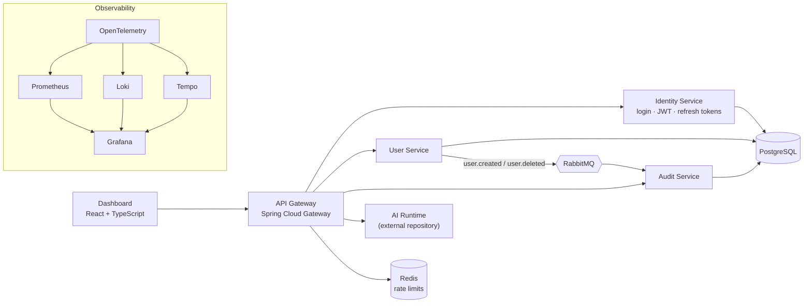

<div align="center">

# Aetheris Platform

**A secure, observable microservices platform built with Java 21, Spring Boot 4 and React.**

[](https://github.com/teldigi5-wq/aetheris-platform/actions/workflows/build.yml)


</div>

---

## What it is

Aetheris is a portfolio project that builds a production-style backend platform from
the ground up and treats **security and verification as first-class features**:

- **Four Spring Boot services** behind an API gateway: identity (login, JWT, refresh
  tokens), users, and an audit log fed by asynchronous events.
- **PostgreSQL, Redis and RabbitMQ**, with full metrics, logs and traces through
  OpenTelemetry, Prometheus, Loki, Tempo and Grafana.
- **Defence in depth**: every backend service verifies signed JWTs itself, so bypassing the
  gateway does not bypass authentication.
- **Evidence-driven CI**: real-container end-to-end proofs, image vulnerability gates,
  dependency scanning, reproducible builds and secret scanning on every change.

A separate repository, [`aetheris-ai-runtime`](https://github.com/teldigi5-wq/aetheris-ai-runtime),
holds the AI orchestration runtime that integrates with this platform through a versioned
contract.

## Architecture



| Service | Responsibility | Port (loopback) |
|---|---|---|
| Dashboard | React UI | 3000 |
| API Gateway | Routing, JWT verification, scopes, rate limits | 8080 |
| User Service | User management, publishes domain events | 8081 |
| Identity Service | Registration, login, access/refresh tokens | 8082 |
| Audit Service | Consumes events into an append-only audit log | 8083 |

All host ports bind to `127.0.0.1` only. Datastores publish no host ports.

## Quick start

**Requirements:** Git, Docker with Compose v2, Python 3.

```bash
git clone https://github.com/teldigi5-wq/aetheris-platform.git
cd aetheris-platform

# Create .env with five unique random secrets (refuses to overwrite an existing .env)
python3 -c "import re,secrets;t=open('.env.example').read();t=re.sub(r'(?m)^(AETHERIS_[A-Z_]+=)$',lambda m:m.group(1)+secrets.token_hex(32),t);open('.env','x').write(t)"

# Local demo only: allow creating an account through the UI/API
echo "AETHERIS_SELF_REGISTRATION_ENABLED=true" >> .env

docker compose up --build
```

Then open <http://localhost:3000>. With observability:
`docker compose --profile observability up --build` (Grafana on <http://localhost:3001>).

The services refuse to start with missing, weak or known placeholder secrets. That is
intentional. See the [demo guide](docs/demo-guide.md) for a guided walkthrough.

## Security highlights

- **JWT everywhere:** the gateway *and* each backend verify signature, issuer, audience,
  expiry and role/scope. RS256 key pinning with bounded key-rotation overlap is supported.
- **Fail-closed configuration:** placeholder and weak secrets are rejected at startup.
  Helm refuses to render weak or reused credentials.
- **Supply chain:** digest-pinned base images, Trivy image gates, CycloneDX SBOMs scanned
  with OSV (588 Java components, 0 known vulnerabilities at last scan), CodeQL,
  OpenSSF Scorecard and reproducible builds.
- **Found and fixed, with proof first:** four real security and reliability bugs, each
  reproduced by a failing CI test before the fix. See
  **[security case studies](docs/security/case-studies.md)**.

Report vulnerabilities as described in [SECURITY.md](SECURITY.md).

## Testing and CI

- Java unit and integration tests in every service, including real-HTTP tests on an
  embedded Tomcat.
- Python policy tests (`tests/`) that guard security invariants such as pinned images,
  fail-closed workflows and Helm safety gates.
- Full-stack proofs that boot the real containers and check authentication, events,
  restarts, startup order and data recovery.
- `main` is protected. Changes land through pull requests with green CI.

## Repository map

```text
gateway/ identity-service/ user-service/ audit-service/   Spring Boot services
dashboard/                                               React + TypeScript UI
apps/syntra-desktop/                                     Tauri desktop client (Rust + JS)
deploy/helm/                                             Kubernetes Helm chart
observability/                                           OTel, Prometheus, Loki, Tempo, Grafana
contracts/ architecture/                                 Cross-repository contracts
tests/ tools/                                            Policy tests and runtime proofs
docs/                                                    Architecture, guides, security notes
```

## Documentation

- [Architecture](docs/architecture.md) · [Architecture decisions](docs/architecture-decisions.md)
- [Security case studies](docs/security/case-studies.md) · [Token flow and threat model](docs/security/token-flow.md)
- [Demo guide](docs/demo-guide.md) · [Kubernetes](docs/kubernetes.md) · [Observability](docs/observability.md)
- [Interview guide](docs/interview-guide.md)
- Project history: [master roadmap](docs/master-roadmap.md) · [October 2026 status ledger](docs/history/README-2026-10-25.md)

## Project status

Active portfolio project. It is **not deployed to production**, and production use would
require an operator security review.

- **Development flow:** work lands on `feature/syntra-aetheris-foundation-v2` through
  reviewed PRs, then is promoted to the protected `main` branch with green CI.
- **Roadmap:** the original repository roadmap reached **Stage 34 / 34**, and that
  history is kept as-is. There is no Stage 35: later work is tracked as normal releases
  in the [current release roadmap](docs/current-release-roadmap-20261025.md). The
  Stage 26 evidence-integrity guard keeps this README from overstating what has been
  verified.
- **AI runtime on real hardware:** status `BLOCKED_PENDING_HARDWARE`.
  Physical-PC validation remains pending. CI evidence is not a substitute for testing on
  the target workstation.

## License

[Apache License 2.0](LICENSE) © Poojana Kaveesh Sellahewa
